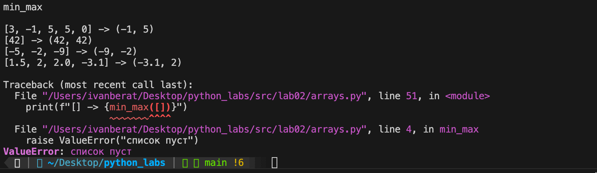
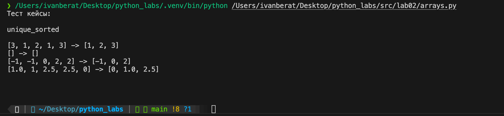
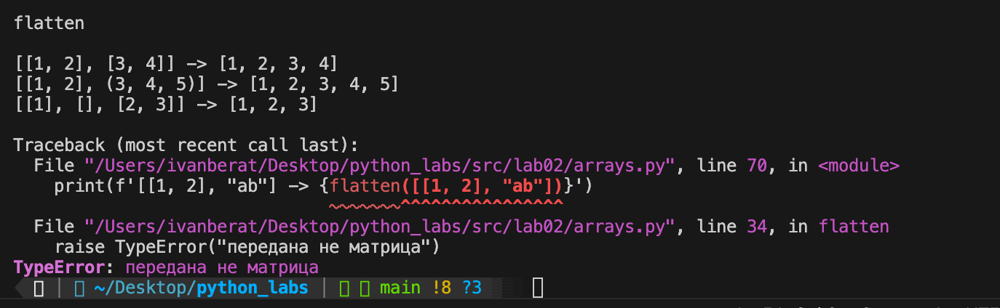
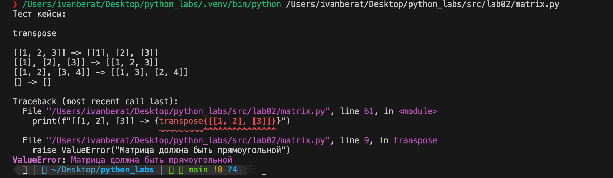
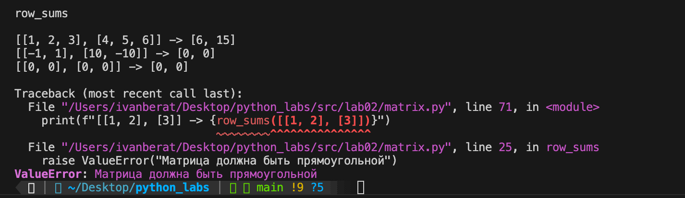
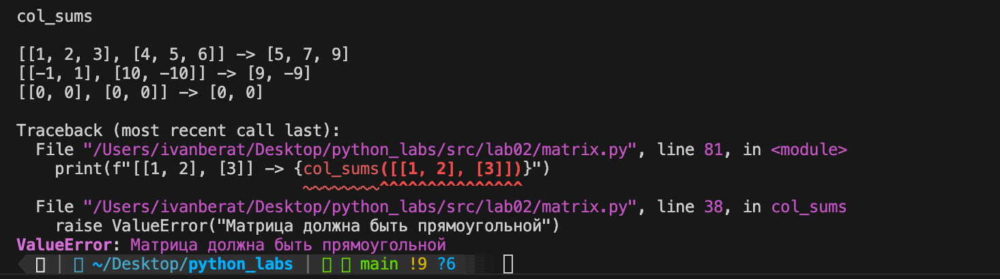
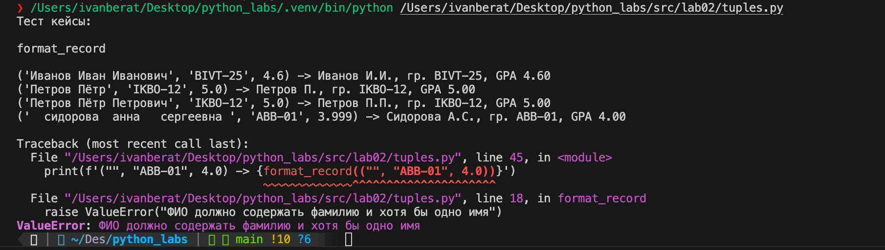

# Отчет по лабораторной работе №2

## Задание A

### 1. min_max

*Рис. 1. Результат выполнения arrays.py min_max (нахождение минимума и максимума списка)*

### 2. unique_sorted

*Рис. 2. Результат выполнения arrays.py unique_sorted (сортировка уникальных элементов)*

### 3. flatten

*Рис. 3. Результат выполнения arrays.py flatten (преобразование матрицы в плоский список)*

## Задание B

### 1. transpose

*Рис. 4. Результат выполнения matrix.py transpose (транспонирование матрицы)*

### 2. row_sums

*Рис. 5. Результат выполнения matrix.py row_sums (суммы элементов по строкам)*

### 3. col_sums

*Рис. 6. Результат выполнения matrix.py col_sums (суммы элементов по столбцам)*

## Задание C

### 1. format_record

*Рис. 7. Результат выполнения tuples.py format_record (форматирование кортежа студента)*
