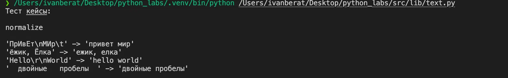
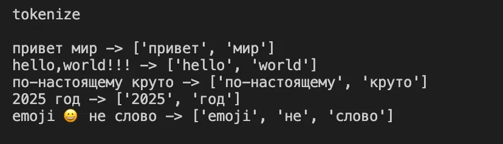
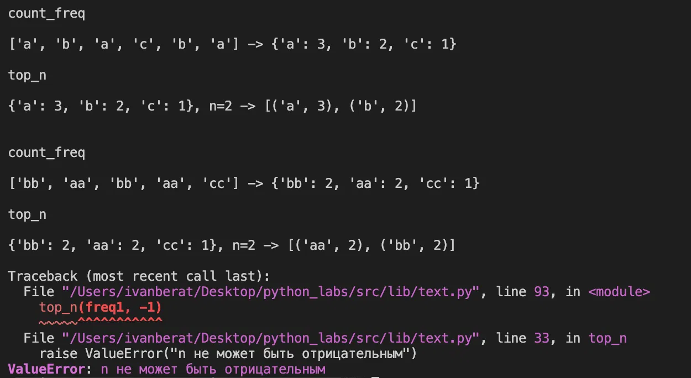
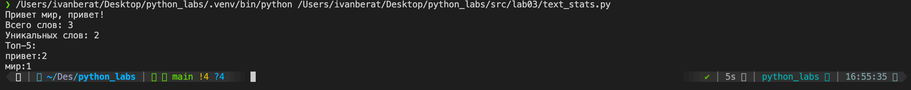
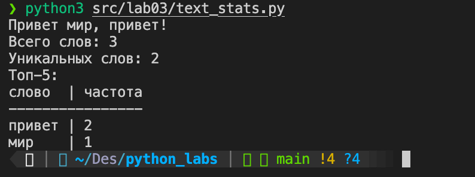

# Отчет по лабораторной работе №3

## Задание A. text.py

Файл: `src/lib/text.py`  
Четыре функции для работы с текстом: `normalize` приводит строку к единому виду, `tokenize` разбивает её на слова, `count_freq` считает частоты слов, `top_n` выбирает самые частые. Внизу файла в блоке `if __name__ == "__main__"` вызваны все функции с примерами.

*Рис. 1. Запуск text.py: проверка normalize*

*Рис. 2. Проверка tokenize*

*Рис. 3. Проверка count_freq и top_n, ошибка при отрицательном n*

## Задание B. text_stats.py

Файл: `src/lab03/text_stats.py`  
Читает текст из stdin и выводит количество слов, количество уникальных слов и топ-5 самых частых. Запуск: `python3 src/lab03/text_stats.py`. Табличный вывод включается константой `TABLE_MODE = True` в начале файла.

*Рис. 4. Запуск text_stats.py*

*Рис. 5. Табличный режим text_stats.py (TABLE_MODE = True)*
