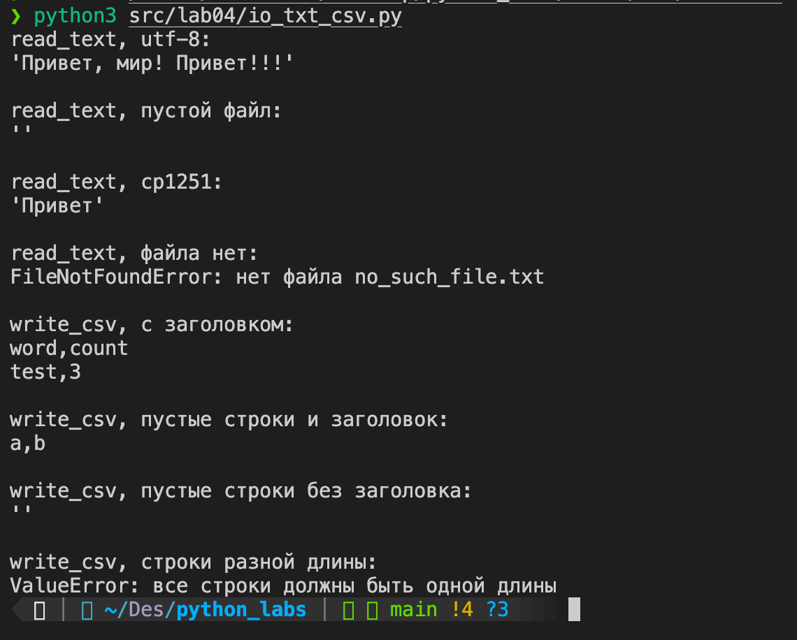
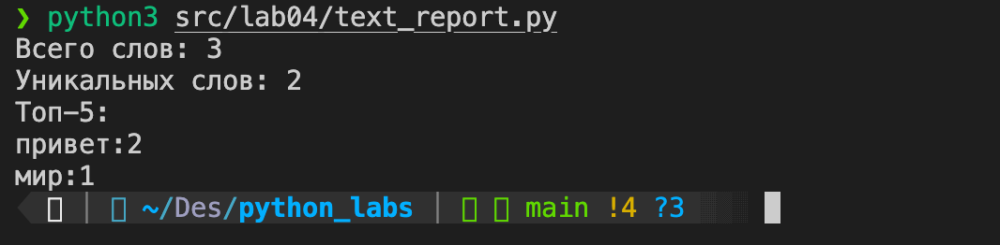
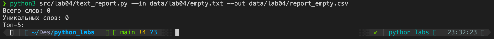
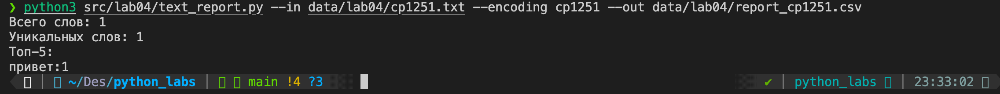
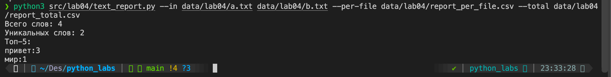
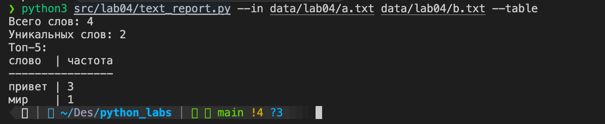

# Отчет по лабораторной работе №4

## Задание A. io_txt_csv.py

### Мини-тесты

Запуск:

```
python3 src/lab04/io_txt_csv.py
```

Консоль:



## Задание B. text_report.py

Аргументы:

- `--in` входные файлы;
- `--out` отчёт для одного файла, по умолчанию `data/lab04/report.csv`;
- `--encoding` кодировка входных файлов, по умолчанию `utf-8`;
- `--per-file` отчёт по каждому файлу (★);
- `--total` сводный отчёт (★);
- `--table` топ-5 таблицей.

## Тест-кейсы

### A. Один файл (база)

Вход (data/lab04/input.txt):

```
Привет, мир! Привет!!!
```

Запуск:

```
python3 src/lab04/text_report.py
```

Консоль:



Отчёт (data/lab04/report.csv):

```
word,count
привет,2
мир,1
```

### B. Пустой файл

Вход (data/lab04/empty.txt): пустой файл, создаётся командой:

```
touch data/lab04/empty.txt
```

Запуск:

```
python3 src/lab04/text_report.py --in data/lab04/empty.txt --out data/lab04/report_empty.csv
```

Консоль:



Отчёт (data/lab04/report_empty.csv):

```
word,count
```

### C. Кодировка cp1251

Вход (data/lab04/cp1251.txt в кодировке cp1251), создаётся командой:

```
python3 -c "open('data/lab04/cp1251.txt', 'wb').write('Привет'.encode('cp1251'))"
```

```
Привет
```

Запуск:

```
python3 src/lab04/text_report.py --in data/lab04/cp1251.txt --encoding cp1251 --out data/lab04/report_cp1251.csv
```

Консоль:



Отчёт (data/lab04/report_cp1251.csv):

```
word,count
привет,1
```

Без `--encoding` файл не читается:

```
python3 src/lab04/text_report.py --in data/lab04/cp1251.txt
Ошибка: 'utf-8' codec can't decode byte 0xcf in position 0: invalid continuation byte
```

Если файла нет:

```
python3 src/lab04/text_report.py --in data/lab04/nope.txt
Ошибка: [Errno 2] No such file or directory: 'data/lab04/nope.txt'
```

### D(★). Несколько файлов

Вход (data/lab04/a.txt):

```
Привет мир
```

Вход (data/lab04/b.txt):

```
Привет, привет!
```

Запуск:

```
python3 src/lab04/text_report.py --in data/lab04/a.txt data/lab04/b.txt \
    --per-file data/lab04/report_per_file.csv \
    --total data/lab04/report_total.csv
```

Консоль:



Пер-файл отчёт (data/lab04/report_per_file.csv):

```
file,word,count
a.txt,мир,1
a.txt,привет,1
b.txt,привет,2
```

Сводный отчёт (data/lab04/report_total.csv):

```
word,count
привет,3
мир,1
```

### Табличный вывод

Запуск:

```
python3 src/lab04/text_report.py --in data/lab04/a.txt data/lab04/b.txt --table
```

Консоль:


