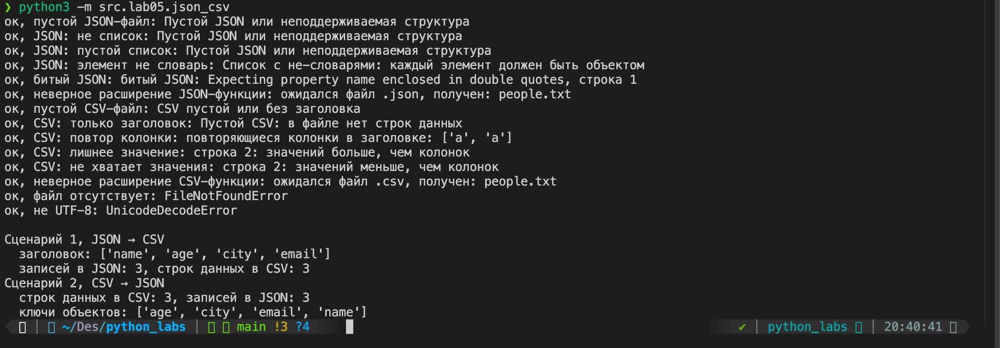
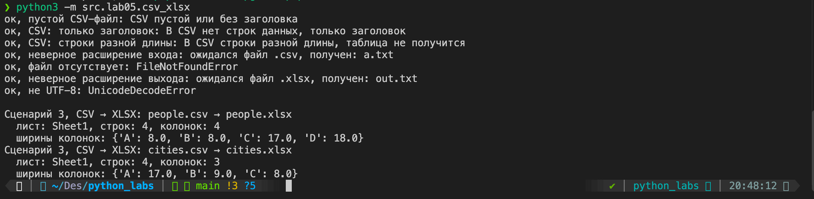
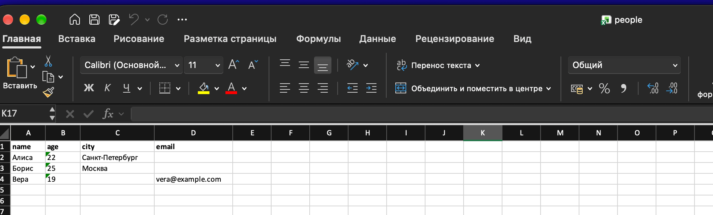
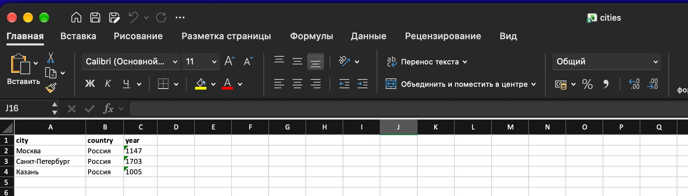

# ЛР5 - JSON и конвертации (JSON↔CSV, CSV→XLSX)

### Задание А. json_csv.py

```python
def _check_suffix(path: Path, suffix: str) -> None:
    """Проверяет расширение файла, иначе ValueError."""
    if path.suffix.lower() != suffix:
        raise ValueError(f"ожидался файл {suffix}, получен: {path.name}")


def _to_cell(value) -> str:
    """Превращает значение из JSON в текст для ячейки CSV.

    None становится пустой строкой, список и словарь — JSON-текстом,
    bool — true/false как в JSON. Остальное — через str().
    """
    if value is None:
        return ""
    if isinstance(value, (list, dict, bool)):
        return json.dumps(value, ensure_ascii=False)
    return str(value)


def json_to_csv(json_path: str, csv_path: str) -> None:
    """Преобразует JSON-файл (список словарей) в CSV.

    Колонки — объединение ключей всех объектов в порядке первого
    появления. Отсутствующие поля записываются пустыми строками.
    Кодировка UTF-8.
    """
    src = Path(json_path)
    _check_suffix(src, ".json")
    text = src.read_text(encoding=ENCODING)
    if not text.strip():
        raise ValueError("Пустой JSON или неподдерживаемая структура")
    try:
        data = json.loads(text)
    except json.JSONDecodeError as error:
        raise ValueError(f"битый JSON: {error.msg}, строка {error.lineno}") from error

    if not isinstance(data, list) or not data:
        raise ValueError("Пустой JSON или неподдерживаемая структура")
    if not all(isinstance(item, dict) for item in data):
        raise ValueError("Список с не-словарями: каждый элемент должен быть объектом")

    # dict.fromkeys убирает повторы и сохраняет порядок первого появления
    columns = list(dict.fromkeys(key for item in data for key in item))

    dst = Path(csv_path)
    dst.parent.mkdir(parents=True, exist_ok=True)
    with dst.open("w", newline="", encoding=ENCODING) as f:
        writer = csv.DictWriter(f, fieldnames=columns)
        writer.writeheader()
        for item in data:
            writer.writerow({key: _to_cell(item.get(key)) for key in columns})


def csv_to_json(csv_path: str, json_path: str) -> None:
    """Преобразует CSV в JSON (список словарей).

    Первая строка — заголовок, он обязателен. Все значения остаются
    строками, потому что в CSV нет типов. Кодировка UTF-8.
    """
    src = Path(csv_path)
    _check_suffix(src, ".csv")
    with src.open(encoding=ENCODING, newline="") as f:
        reader = csv.DictReader(f)
        header = reader.fieldnames
        if not header:
            raise ValueError("CSV пустой или без заголовка")
        if len(set(header)) != len(header):
            raise ValueError(f"повторяющиеся колонки в заголовке: {header}")

        records = []
        for row in reader:
            if None in row:
                raise ValueError(f"строка {reader.line_num}: значений больше, чем колонок")
            if None in row.values():
                raise ValueError(f"строка {reader.line_num}: значений меньше, чем колонок")
            records.append(row)

    if not records:
        raise ValueError("Пустой CSV: в файле нет строк данных")

    dst = Path(json_path)
    dst.parent.mkdir(parents=True, exist_ok=True)
    with dst.open("w", encoding=ENCODING) as f:
        json.dump(records, f, ensure_ascii=False, indent=2)
```

1. Проверяется расширение входного файла (`.json` или `.csv`). Отсутствующий файл даёт `FileNotFoundError`, его поднимает `open`.
2. Файл читается в кодировке UTF-8. Пустой файл или файл из одних пробелов даёт `ValueError`.
3. `json.loads()` превращает текст в Python-объект. Если это не список словарей или список пуст, выдаётся `ValueError`.
4. Колонки — объединение ключей всех объектов в порядке первого появления (`dict.fromkeys`).
5. Отсутствующее поле получает пустую строку: `item.get()` возвращает `None`, а `_to_cell` превращает его в `""`.
6. Значения: `None` — пустая ячейка, список и словарь — JSON-текст, `bool` — `true`/`false`, остальное через `str()`.
7. `csv_to_json` читает CSV через `csv.DictReader`: первая строка становится ключами, остальные — словарями. Без заголовка, с повторяющимися колонками, со строкой с лишним или недостающим значением — `ValueError`.
8. Пустой CSV без строк данных — `ValueError`.
9. Все значения остаются строками, потому что в CSV нет типов. Запись через `json.dump(..., ensure_ascii=False, indent=2)`.

### Задание В. csv_xlsx.py

```python
def csv_to_xlsx(csv_path: str, xlsx_path: str) -> None:
    """Конвертирует CSV в XLSX.

    Первая строка CSV — заголовок (жирным). Лист называется Sheet1.
    Ширина колонки — по самой длинной ячейке, но не меньше 8 символов.
    """
    src = Path(csv_path)
    _check_suffix(src, ".csv")
    dst = Path(xlsx_path)
    _check_suffix(dst, ".xlsx")

    with src.open(encoding=ENCODING, newline="") as f:
        # csv.reader отдаёт пустую строку файла как [], такие строки пропускаем
        rows = [row for row in csv.reader(f) if row]

    if not rows:
        raise ValueError("CSV пустой или без заголовка")
    if len(rows) < 2:
        raise ValueError("В CSV нет строк данных, только заголовок")
    width = len(rows[0])
    if any(len(row) != width for row in rows):
        raise ValueError("В CSV строки разной длины, таблица не получится")

    wb = Workbook()
    ws = wb.active
    ws.title = SHEET_NAME
    for row in rows:
        ws.append(row)

    for cell in ws[1]:
        cell.font = Font(bold=True)

    # zip(*rows) даёт колонки; ширина — по самой длинной ячейке + запас 2
    for index, column in enumerate(zip(*rows), start=1):
        longest = max(len(value) for value in column)
        ws.column_dimensions[get_column_letter(index)].width = max(MIN_WIDTH, longest + 2)

    dst.parent.mkdir(parents=True, exist_ok=True)
    wb.save(dst)
```

1. Проверяются расширения `.csv` и `.xlsx`. Отсутствующий входной файл даёт `FileNotFoundError`.
2. `csv.reader` читает строки, пустые строки пропускаются.
3. Нужна хотя бы одна строка данных кроме заголовка, иначе `ValueError`. Строки разной длины тоже дают `ValueError`.
4. Лист называется `Sheet1`, первая строка выделена жирным.
5. Ширина колонки — длина самой длинной ячейки + 2 символа, но не меньше 8.
6. Папка для результата создаётся при необходимости, файл сохраняется через `wb.save`.

## Обработка ошибок

1. Отсутствие входного файла: `FileNotFoundError`.
2. Неверный тип файла: `ValueError` (расширение `.json`, `.csv`, `.xlsx`).
3. Пустой JSON или неподдерживаемая структура: `ValueError` (пустой файл, пустой список, не список, элемент не словарь).
4. Пустой CSV или CSV без данных: `ValueError` (пустой файл, только заголовок, повторяющиеся колонки, строка с лишним или недостающим значением).
5. Разные ключи в JSON: колонки CSV — объединение всех ключей, недостающие значения — пустые строки.
6. Типы: при CSV → JSON все значения строки. При JSON → CSV вложенные списки и словари пишутся JSON-текстом и обратно не восстанавливаются.
7. Не UTF-8: `UnicodeDecodeError`, это подкласс `ValueError`.

## Способ запуска

Запуск из корня репозитория через `-m`. Для задания B нужен openpyxl:

```
pip install -r requirements.txt
python3 -m src.lab05.json_csv
python3 -m src.lab05.csv_xlsx
```

Использование функций из кода:

```python
from src.lab05.json_csv import json_to_csv, csv_to_json
from src.lab05.csv_xlsx import csv_to_xlsx

json_to_csv("data/samples/people.json", "data/out/people_from_json.csv")
csv_to_json("data/samples/people.csv", "data/out/people_from_csv.json")
csv_to_xlsx("data/samples/people.csv", "data/out/people.xlsx")
```

## Проверка результатов

1. JSON → CSV



2. CSV → JSON


3. CSV → XLSX



`people.xlsx`:



`cities.xlsx`:



4. Пустой JSON-файл


5. Битый JSON-файл


