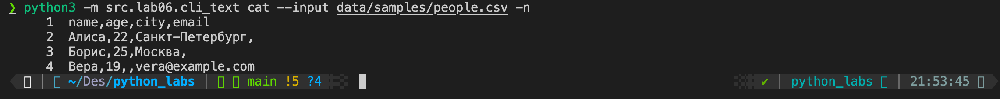
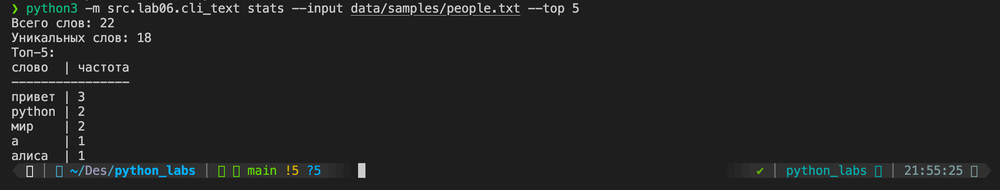
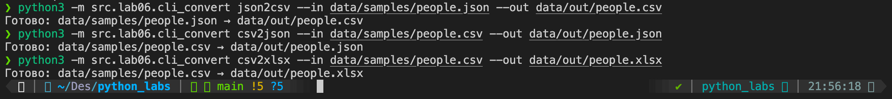
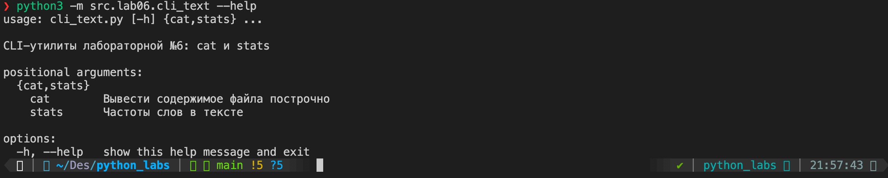
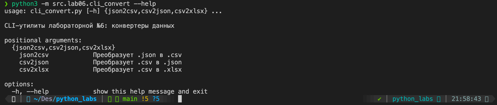
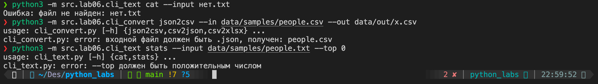

# ЛР6 - CLI-утилиты с argparse (cat, stats, конвертеры)

Запуск из корня репозитория. Для конвертеров нужны функции из ЛР5 и openpyxl (`pip install -r requirements.txt`).

### Задание А. cli_text.py

Файл: `src/lab06/cli_text.py`. Две подкоманды, `cat` и `stats`.

**cat** — `--input <путь> [-n]`. Печатает файл построчно, `-n` нумерует строки с 1.

```
python3 -m src.lab06.cli_text cat --input data/samples/people.csv -n
```



**stats** — `--input <путь> [--top N]`. Печатает число слов, число уникальных слов и `N` самых частых слов (по умолчанию 5). Используются `normalize`, `tokenize`, `count_freq`, `top_n` из ЛР3 и `print_table` из `src/lab03/text_stats.py`.

```
python3 -m src.lab06.cli_text stats --input data/samples/people.txt --top 5
```



### Задание Б. cli_convert.py

Файл: `src/lab06/cli_convert.py`. Подкоманды вызывают функции из ЛР5. Параметры одинаковые: `--in` входной файл, `--out` выходной файл.

| Команда | Что делает | Пример |
|---|---|---|
| `json2csv` | JSON → CSV | `--in data/samples/people.json --out data/out/people.csv` |
| `csv2json` | CSV → JSON | `--in data/samples/people.csv --out data/out/people.json` |
| `csv2xlsx` | CSV → XLSX | `--in data/samples/people.csv --out data/out/people.xlsx` |

```
python3 -m src.lab06.cli_convert json2csv --in data/samples/people.json --out data/out/people.csv
python3 -m src.lab06.cli_convert csv2json --in data/samples/people.csv --out data/out/people.json
python3 -m src.lab06.cli_convert csv2xlsx --in data/samples/people.csv --out data/out/people.xlsx
```



### Справка

```
python3 -m src.lab06.cli_text --help
python3 -m src.lab06.cli_text stats --help
python3 -m src.lab06.cli_convert --help
python3 -m src.lab06.cli_convert json2csv --help
```





### Ошибки

- Нет входного файла: `Ошибка: файл не найден: ...`, код выхода 1.
- Неверное расширение (например, `json2csv --in people.csv`): `входной файл должен быть .json, получен: people.csv`, код 2 (ошибка argparse).
- Файл не в UTF-8: `Ошибка: не удалось прочитать файл в кодировке UTF-8`, код 1.
- `stats --top 0`: `--top должен быть положительным числом`, код 2 (ошибка argparse).
- Подкоманда не указана: ошибка argparse, код 2.


